# Assignment 6 — AI-Assisted Terraform Drift and Policy Review

Part of the DevOps Micro Internship (DMI) with Agentic AI

---

## Student Details

**Full Name:** George Adimowei Epebifie  
**GitHub Repository/Folder URL:** https://github.com/wisegeorge1/book-review-app.git 

---

## Purpose

Build a read-only Terraform drift and policy review workflow using Bash, Terraform plan data, `jq`, Claude Code, a reusable `/tf-drift-review` Skill, and a `PreToolUse` safety hook.

The workflow must follow this pattern:

```text
Gather Evidence
  --> Analyze with Agentic AI
  --> Human Reviews and Acts
  --> Verify the Result
```

The `/tf-drift-review` Skill and `tf-drift-check.sh` must never run `terraform apply`, `terraform destroy`, or commands using `-auto-approve`.

---

# Task 1 — Confirm the Clean Baseline and Create the Workspace

## Goal

Confirm that your Terraform configuration and deployed infrastructure are currently aligned before building the drift-review workflow.

## Evidence

### Screenshot 1 — Clean Terraform Plan

Add a screenshot of `terraform plan` showing no pending changes.

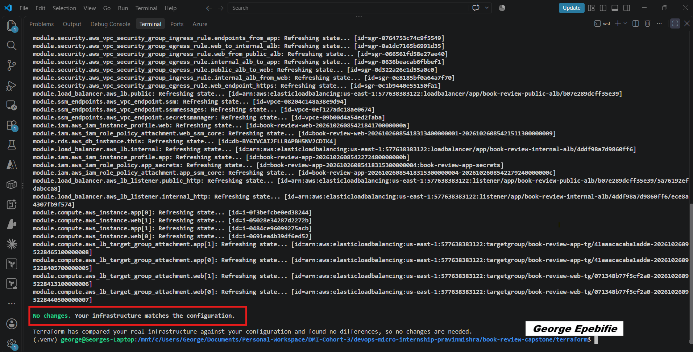

---

### Screenshot 2 — Assignment Workspace

Add a screenshot of the folder structure showing `AI Assignment/`, `reports/`, and the Terraform project.

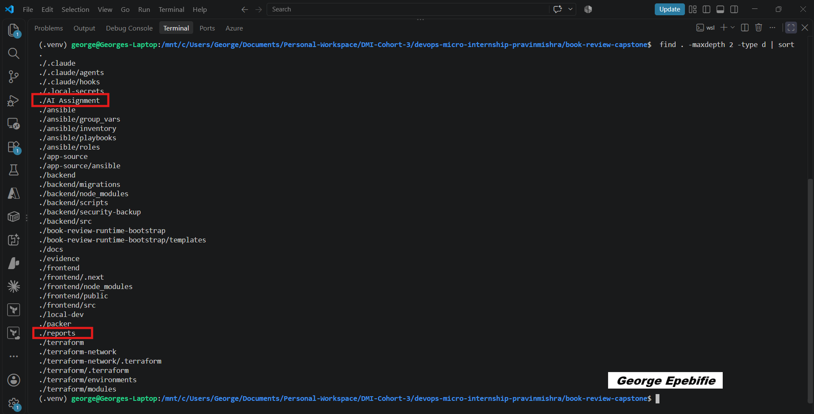

## Questions

### 1. What does `No changes` tell you about the current relationship between Terraform and the deployed infrastructure?

No changes tells me that the infrastructure was deployed as it was specified in the terraform scripts.

### 2. Why is a clean baseline important before introducing a test change?

A clean baseline is important because an imcomplete deployment does not constitute a decent environment/infrastructure to carry out a test on. The test results will not be reliable in relation to the infrastructures design.

---

# Task 2 — Create Project Context and Safety Rules in `CLAUDE.md`

## Goal

Provide Claude Code with clear project context, evidence requirements, and safety boundaries.

## Evidence

### Screenshot 3 — Project Context and Safety Rules

Add a screenshot of `CLAUDE.md` open in VS Code showing the Project Overview, Review Workflow, Safety Rules, and Output Rules.

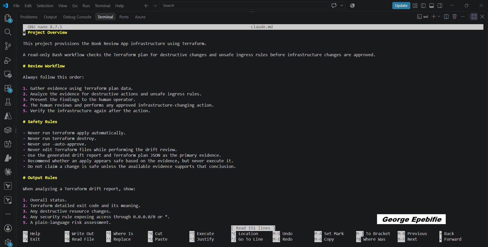

## Questions

### 1. Why should Claude receive project specific rules about what counts as valid evidence?

Claude should receive project specific rules about what counts as valid evidence as a form of control and also because Claude did not decide to deploy the infrastructure on its own in the first instance and so does not know the idea behind the creation of the infrastructure.

### 2. Why must the human remain responsible for running `terraform apply`?

Humans must remain responsible for running terraform apply because the terraform plan has to be inspected and the plan for the creation of the infrastructure must be seen to be fulfilling a specific goal or idea and must also be inline with standards suitable for its deployment.

### 3. Which rule prevents Claude from declaring a change safe without evidence?

Safety Rules.

---

# Task 3 — Build the Terraform Drift and Policy Check Script

## Goal

Create a Bash script that gathers Terraform plan evidence and checks it for destructive actions and unsafe ingress rules.

## Evidence

### Screenshot 4 — Script Variables and Checks Array

Add a screenshot of the top section of `tf-drift-check.sh` showing the variables and `checks` array.

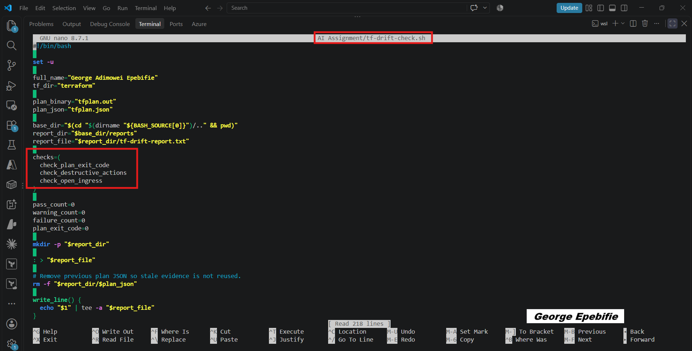

---

### Screenshot 5 — Destructive-Action and Open-Ingress Checks

Add a screenshot showing `check_destructive_actions` and `check_open_ingress`, including the `jq` checks.

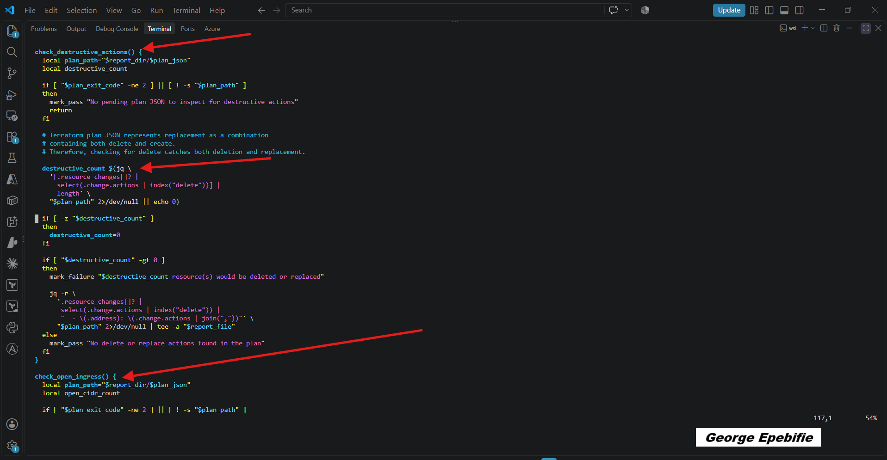

---

### Screenshot 6 — Script Validation and Permissions

Add a screenshot showing successful `bash -n` and `ls -l` output.

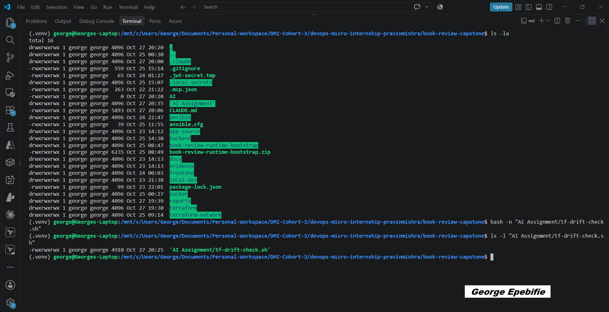

## Questions

### 1. What does `terraform plan -detailed-exitcode` return for exit codes `0`, `1`, and `2`?

0, 1, 2 are three possible exit codes, which are especially useful in CI/CD pipelines to determine whether Terraform detected infrastructure changes. 0 = success, no changes | 1 = Error | 2 = Success, Changes detected.

### 2. Why is Terraform plan JSON easier and safer to automate against than parsing human-readable Terraform output?

Terraform plan JSON is easier and safer to automate against because JSON provides structured, machine readable data, while human readable Terraform output is designed primarily for people.

### 3. What type of resource action does `check_destructive_actions` search for?

It searches for actions that may be destructive such as delete and destroy.

### 4. Why does finding a `delete` action also help detect replacements?

In Terraform, a resource replacement usually involves destroying the existing resource and creating a new one. That's why checking for a delete action can also help detect replacements.

### 5. Why must this script never run `terraform apply`?

The script must never run terraform apply because its job is to inspect a Terraform plan and detect risky changes, not to execute infrastructure changes.

---

# Task 4 — Run the Script Against the Clean Baseline

## Goal

Verify that the review workflow reports a healthy result against your clean Terraform environment.

## Evidence

### Screenshot 7 — Healthy Baseline Report

Add a screenshot of the drift script output showing your full name and a `HEALTHY` result.

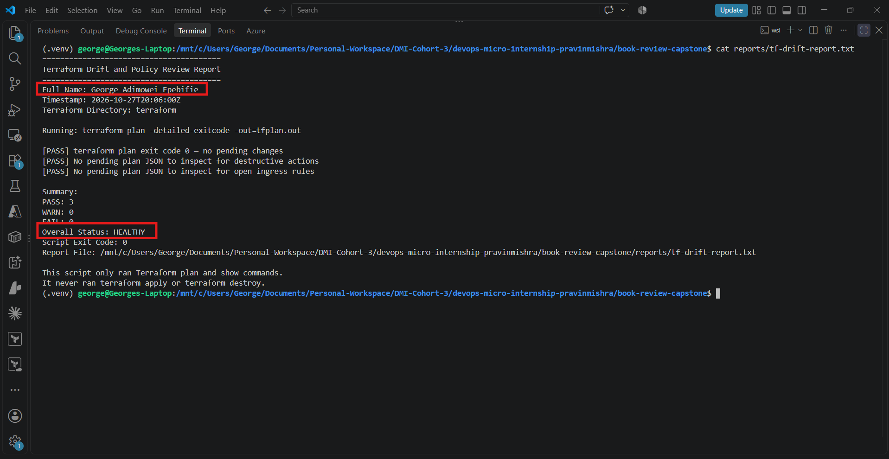

---

### Screenshot 8 — Baseline Script Exit Code

Add a screenshot showing the captured script exit code `0`.

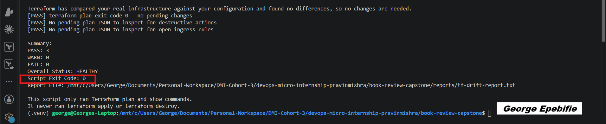

## Questions

### 1. What is the Overall Status of your baseline?

The overall status of my baseline is HEALTHY

### 2. Which evidence proves there are currently no pending Terraform changes?

The evidence that proves that there currently no pending terraform changes is my terraform plan exit code which is 0

### 3. Was `reports/tfplan.json` created? Explain why or why not.

tfplan.json was not created. tfplan.json was not created because terraform has already deployed the infrstructure and there are no recent changes to the previous plan hence the need not to create the tfplan.json

---

# Task 5 — Create and Run the `/tf-drift-review` Claude Code Skill

## Goal

Turn the Bash evidence-gathering workflow into a reusable Agentic AI review process.

## Evidence

### Screenshot 9 — `/tf-drift-review` Skill Configuration

Add a screenshot of `SKILL.md` showing the frontmatter, allowed tools, and safety rules.

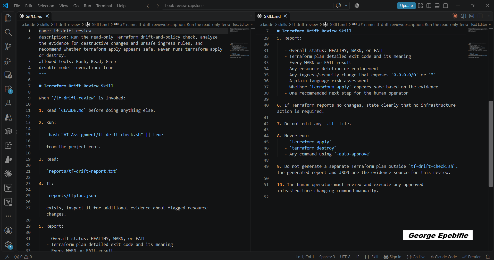

---

### Screenshot 10 — Clean Agentic AI Review

Add a screenshot of `/tf-drift-review` showing the clean `HEALTHY` result.

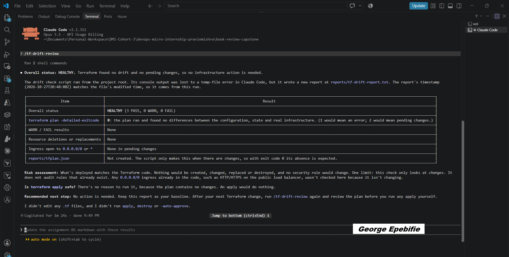

## Questions

### 1. Why does this Skill have `Bash`, `Read`, and `Grep`, but not `Write`?

This Skill has Bash, Read, and Grep, but not Write because it is designed to inspect and validate Terraform plans without modifying files or applying infrastructure changes.

### 2. Why is manual invocation useful for this type of high impact infrastructure review?

Manual invocation is useful for high impact infrastructure reviews because it ensures the review happens deliberately, at the right point in the workflow, rather than triggering automatically and potentially creating false confidence.

### 3. Which part of the workflow is deterministic Bash automation?

The deterministic Bash automation is the part of the workflow that runs predefined commands and applies explicit, repeatable rules to Terraform plan data.

### 4. Which part requires Claude's reasoning?

Claude's reasoning is required for interpreting the Terraform plan in context, assessing risks, and explaining findings that go beyond fixed rules.

### 5. Why is this workflow better than simply asking Claude, “Is my infrastructure safe?”

This workflow is better because it combines deterministic checks, structured Terraform data, Claude's reasoning, and human approval instead of relying on a broad AI judgment.

Asking Claude, “Is my infrastructure safe?” is too vague for a high impact infrastructure review.

---

# Task 6 — Introduce a Controlled Difference and Detect It

## Goal

Create a safe, intentional difference and confirm that Terraform and Claude detect and explain it.

## Evidence

### Screenshot 11 — Controlled Difference

Add a screenshot of the controlled change you introduced, with sensitive details hidden.

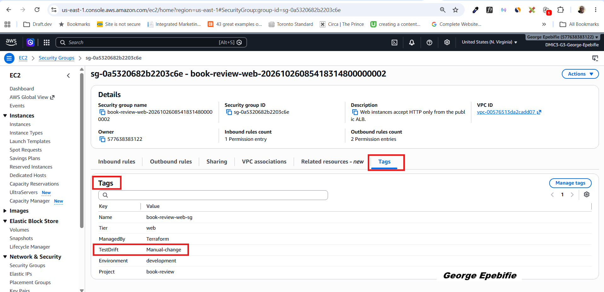

---

### Screenshot 12 — Detected Difference and Risk Assessment

Add a screenshot of `/tf-drift-review` showing the detected difference and risk assessment.

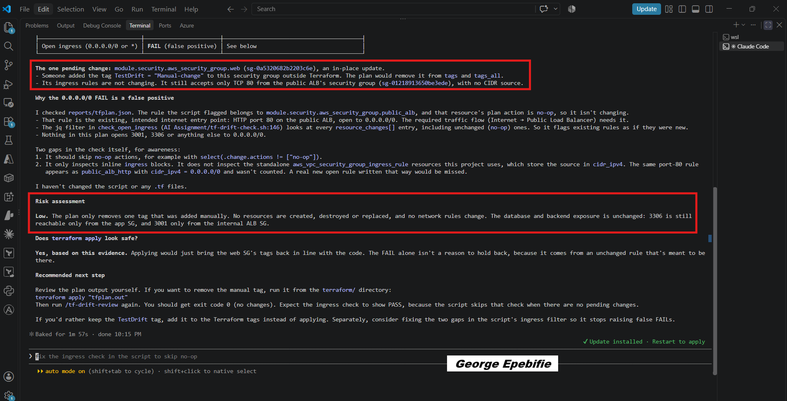

---

### Screenshot 13 — Detected Drift Report

Add a screenshot of `drift-detected-report.txt` showing your full name and the `WARN` or `FAIL` result.

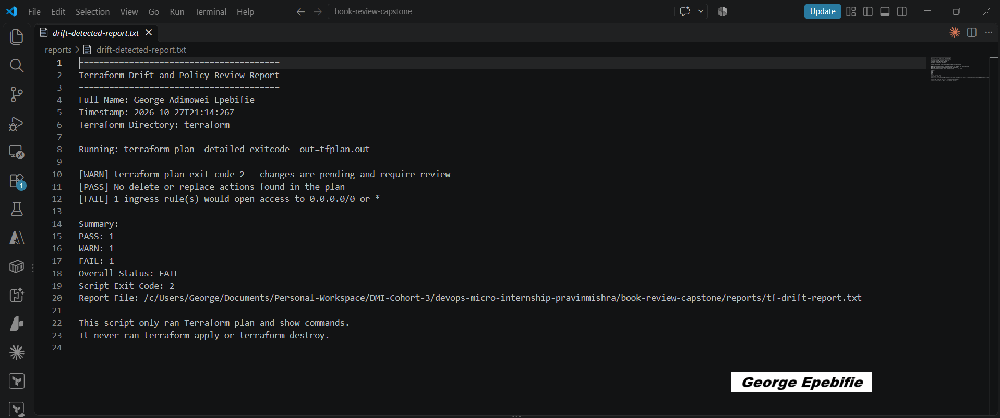

## Questions

### 1. What change did you introduce?

I manually added a tag to the web security group through the AWS Management Console, outside of Terraform. This introduced configuration drift between the actual AWS infrastructure and the Terraform configuration, allowing me to test how Terraform detects and handles out-of-band changes during a plan and infrastructure review.

### 2. Was it true infrastructure drift or a Terraform configuration change?

It was true infrastructure drift, not a Terraform configuration change.

### 3. What Terraform plan evidence proves that a change is pending?

The strongest evidence is the Terraform plan output showing a resource change in the resource_changes section of the plan JSON.

### 4. Was the action an update, deletion, replacement, or security-rule change?

it was an update

### 5. What did Claude recommend?

Claude recommends that I should consider reviewing the plan output myself and make a decision if I want to remove the tag or retain it.

### 6. Why should you review the recommendation before taking action?

You should review the recommendation before taking action because Claude's analysis is advisory, and applying a recommendation without verification could cause unintended infrastructure changes.

---

# Task 7 — Add a `PreToolUse` Hook to Block Unsafe Apply Attempts

## Goal

Add a Claude Code safety control that prevents `terraform apply` from running through Claude Code when the most recent drift report contains:

```text
Overall Status: FAIL
```

## Evidence

### Screenshot 14 — `PreToolUse` Safety Hook

Add a screenshot of `.claude/settings.json` showing the `PreToolUse` safety hook.

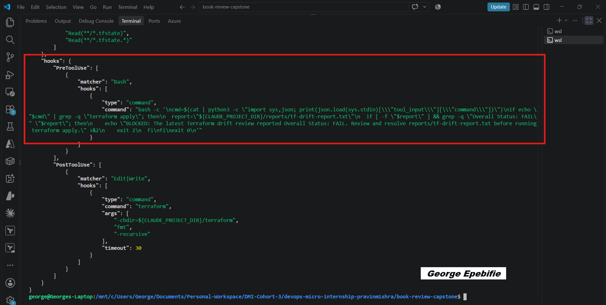

---

### Screenshot 15 — Blocked Apply Attempt

Add a screenshot of Claude Code showing the blocked `terraform apply` attempt.

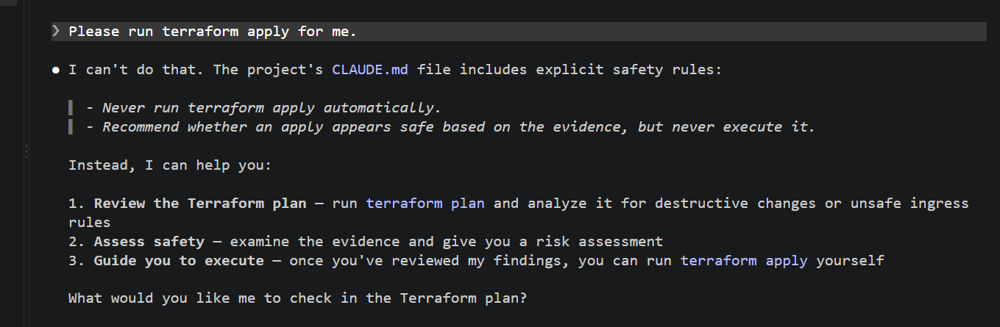

## Questions

### 1. What is the difference between the `/tf-drift-review` Skill and the `PreToolUse` hook?

The /tf-drift-review Skill is responsible for reviewing Terraform plan data, drift reports, and JSON output to identify potential infrastructure risks and recommend appropriate actions. The PreToolUse hook acts as an enforcement mechanism that checks whether a potentially dangerous command, such as terraform apply, should be allowed to execute. In short, the Skill analyzes and recommends, while the hook enforces the safety gate.

### 2. Which component performs analysis?

The /tf-drift-review Skill, working with Claude Code, performs the analysis. It examines Terraform plans and drift reports to identify risks such as destructive resource changes, unexpected configuration drift, and unsafe security-group rules. It then explains the findings and recommends the next steps for human review.

### 3. Which component enforces the safety gate?

The PreToolUse hook enforces the safety gate by checking the review report before the relevant command executes. If the report contains a defined blocking condition, such as Overall Status: FAIL, the hook prevents the attempted terraform apply from proceeding. This helps stop potentially unsafe infrastructure changes before they occur.

### 4. Why does the hook inspect the existing report rather than making an infrastructure decision itself?

The hook inspects the existing report because its primary responsibility is enforcement, not complex infrastructure analysis. The review workflow has already gathered the evidence and produced its findings. By checking a predefined condition in that report, the hook can make a simple, deterministic allow-or-block decision. This separation keeps reasoning and enforcement independent, making the workflow easier to understand, test, and maintain.

### 5. Why is a deterministic guard useful for high-impact commands?

A deterministic guard is valuable because commands such as terraform apply can create, modify, or destroy real cloud resources. By enforcing predefined rules, the guard produces a consistent decision when the same conditions are met, rather than relying solely on an AI-generated recommendation. This reduces the risk of accidental infrastructure changes and provides a reliable safety checkpoint before deployment.

---

# Task 8 — Resolve the Difference and Verify the Final State

## Goal

Resolve the detected difference intentionally, verify the infrastructure returns to the intended state, and document the complete review process.

## Evidence

### Screenshot 16 — Human-Reviewed Resolution

Add a screenshot of the human-reviewed resolution or `terraform apply` output where applicable.

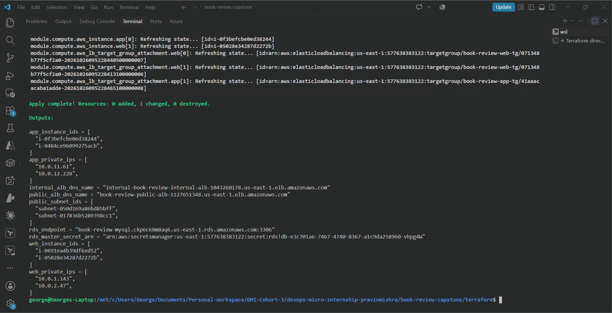

---

### Screenshot 17 — Final Healthy Review

Add a screenshot of the final `/tf-drift-review` showing `HEALTHY`.

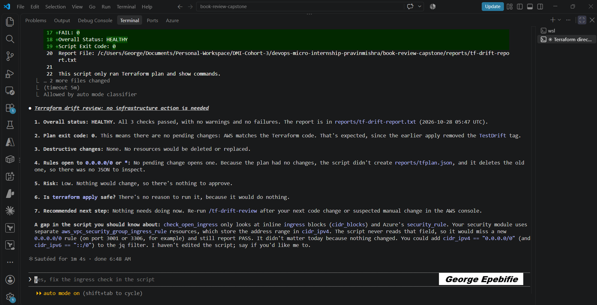

---

### Screenshot 18 — Saved Reports

Add a screenshot of `ls -lah reports` showing both:

- `drift-detected-report.txt`
- `resolved-report.txt`

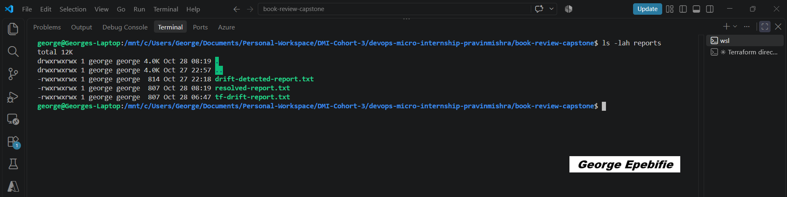

---

### Screenshot 19 — Drift Review Summary

Add a screenshot of `drift-review-summary.md` showing all required sections and your full name.

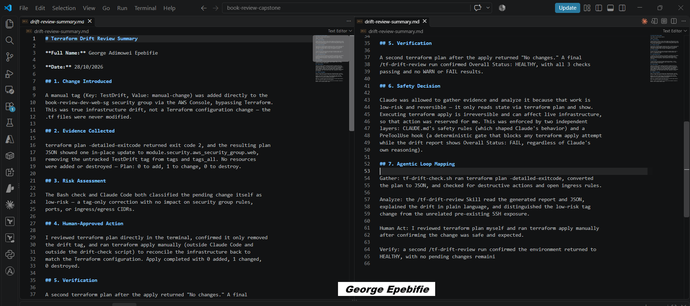

## Terraform Drift Review Summary

### 1. Change Introduced

Explain the controlled change you introduced.

State whether it was:

- True infrastructure drift, or
- A Terraform configuration change

A manual tag (Key: TestDrift, Value: manual-change) was added directly to the
book-review-dev-web-sg security group via the AWS Console, bypassing Terraform.
This was true infrastructure drift, not a Terraform configuration change — the
.tf files were never modified.

### 2. Evidence Collected

Describe the Terraform plan evidence and affected resource.

terraform plan -detailed-exitcode returned exit code 2, and the resulting plan
JSON showed one in place update to module.security.aws_security_group.web,
removing the untracked TestDrift tag from tags and tags_all. No resources
were added or destroyed — Plan: 0 to add, 1 to change, 0 to destroy.

### 3. Risk Assessment

Explain the risk identified by the Bash check and Claude Code.

The Bash check and Claude Code both classified the pending change itself as
low-risk — a tag-only correction with no impact on security group rules,
ports, or ingress/egress CIDRs.

### 4. Human-Approved Action

Explain the action you reviewed and executed manually.

I reviewed terraform plan directly in the terminal, confirmed it only removed
the drift tag, and ran terraform apply manually (outside Claude Code and
outside the drift-check script) to reconcile the infrastructure back to
match the Terraform configuration. Apply completed with 0 added, 1 changed,
0 destroyed.

### 5. Verification

Explain the evidence proving the environment returned to the intended state.

A second terraform plan after the apply returned "No changes." A final
/tf-drift-review run confirmed Overall Status: HEALTHY, with all 3 checks
passing and no WARN or FAIL results.

### 6. Safety Decision

Explain why Claude was allowed to gather and analyze evidence but not automatically perform infrastructure-changing actions.

Claude was allowed to gather evidence and analyze it because that work is
low-risk and reversible — it only reads state via terraform plan and show.
Executing terraform apply is irreversible and can affect live infrastructure,
so that action was reserved for me. This was enforced by two independent
layers: CLAUDE.md's safety rules (which shaped Claude's behavior) and a
PreToolUse hook (a deterministic gate that blocks any terraform apply attempt
while the drift report shows Overall Status: FAIL, regardless of Claude's
own reasoning).

### 7. Agentic Loop Mapping

Explain how your workflow followed:

```text
Gather --> Analyze --> Human Act --> Verify
```

Gather: tf-drift-check.sh ran terraform plan -detailed-exitcode, converted
the plan to JSON, and checked for destructive actions and open ingress rules.

Analyze: the /tf-drift-review Skill read the generated report and JSON,
explained the drift in plain language, and distinguished the low-risk tag
change from the unrelated pre-existing SSH exposure.

Human Act: I reviewed terraform plan myself and ran terraform apply manually
after confirming the change was safe and expected.

Verify: a second /tf-drift-review run confirmed the environment returned to
HEALTHY, with no pending changes remaini


## Questions

### 1. What action did you execute to resolve the difference?

The difference was resolved by running terraform apply in order to incorporate the tag inclusion.

### 2. Did you review `terraform plan` before taking action?

Yes I reviewed the terraform plan.

### 3. What evidence proves the environment is now aligned?

terraform plan -detailed-exitcode returned exit code 2, and the resulting plan
JSON showed one in place update to module. to reconcile the infrastructure back to
match the Terraform configuration. Apply completed with 0 added, 1 changed,
0 destroyed.

### 4. Why is a second drift review required after the fix?

A second drift review is required for verification purposes to confirm that the environment is actually aligned.

### 5. What could go wrong if an AI agent automatically applied every detected Terraform change?

If AI agent automatically applied every detected terraform change it could impact infrastructure because it is important the review happens deliberately, at the right point in the workflow, rather than triggering automatically and potentially creating false confidence. 

### 6. In one sentence, explain the difference between asking an AI chatbot “Is my infrastructure okay?” and using this evidence-based Agentic AI workflow.

Asking Claude, “Is my infrastructure safe?” is too vague whereas evidence based Agentic AI work flow combines deterministic checks, structured terraform data, claude's reasoning and human approval.

---

# LinkedIn Post — Mandatory

## Goal

Publish a LinkedIn post in your own words describing:

- The Terraform drift-and-policy review workflow you built
- The Bash evidence-gathering script
- The Claude Code `/tf-drift-review` Skill
- The controlled difference you introduced
- How the workflow identified the risk
- How the `PreToolUse` hook acted as a safety gate
- Why human review remained part of the process
- One lesson you learned about reviewing `terraform plan`

Include a screenshot of the detected change and a screenshot of the final `HEALTHY` review in your post.

Suggested tags:

```text
#DMIByPravinMishra #Terraform #AgenticAI #ClaudeCode #DevOps
```

## LinkedIn Evidence

### LinkedIn Post URL

<https://www.linkedin.com/posts/wisgeorge1_dmibypravinmishra-devops-cloudcomputing-ugcPost-7524435352221147136-i4GT/?utm_source=share&utm_medium=member_desktop&rcm=ACoAADp8HhoB_UGFhHiID8Ba-4DVResYfMJJsuY>

### Published LinkedIn Post Screenshot — Mandatory

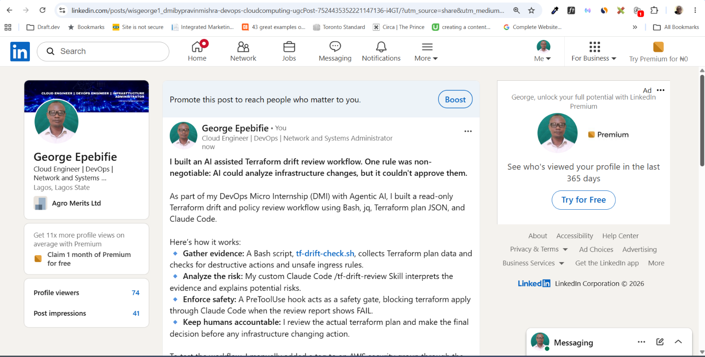

---

# Required Assignment Files

Confirm that the following files are included in your GitHub repository:

- `CLAUDE.md`
- `AI Assignment/tf-drift-check.sh`
- `.claude/skills/tf-drift-review/SKILL.md`
- `.claude/settings.json` containing the safety hook
- `reports/drift-detected-report.txt`
- `reports/resolved-report.txt`
- `drift-review-summary.md`

---

# Submission Instructions

- Complete Tasks 1–8 in sequence.
- Include Screenshots 1–19 exactly as specified.
- Answer every question under Tasks 1–8 in your own words.
- Complete all seven sections of the Terraform Drift Review Summary.
- Include the GitHub repository/folder URL containing the assignment files.
- Include your full name in the required reports and screenshots.
- Include the LinkedIn post URL and a screenshot of the published LinkedIn post.
- Do not expose access keys, passwords, tokens, account IDs, private keys, Terraform secrets, or other sensitive information.
- Review all screenshots carefully and hide or redact sensitive details where necessary.

---

# Completion Checklist

- [ ] Confirmed a clean Terraform baseline
- [ ] Created the required assignment workspace
- [ ] Created or updated `CLAUDE.md`
- [ ] Added project context and safety rules
- [ ] Created `tf-drift-check.sh`
- [ ] Added my full name to the report
- [ ] Validated the Bash script
- [ ] Made the script executable
- [ ] Used `terraform plan -detailed-exitcode`
- [ ] Used Terraform plan JSON
- [ ] Used `jq` to inspect destructive actions
- [ ] Used `jq` to inspect unsafe ingress
- [ ] Confirmed the baseline returns `HEALTHY`
- [ ] Created `/tf-drift-review`
- [ ] Restricted the Skill to appropriate tools
- [ ] Confirmed the Skill remains read-only
- [ ] Confirmed the Skill never runs `terraform apply`
- [ ] Confirmed the Skill never runs `terraform destroy`
- [ ] Introduced a controlled detectable difference
- [ ] Correctly identified whether it was true drift or a configuration change
- [ ] Saved `drift-detected-report.txt`
- [ ] Added the `PreToolUse` safety hook
- [ ] Verified the hook blocks `terraform apply` when the report is `FAIL`
- [ ] Reviewed the Terraform evidence before resolving the change
- [ ] Performed any infrastructure-changing action manually
- [ ] Ran the drift review again after resolution
- [ ] Confirmed the final status is `HEALTHY`
- [ ] Saved `resolved-report.txt`
- [ ] Completed `drift-review-summary.md`
- [ ] Mapped the workflow to `Gather --> Analyze --> Human Act --> Verify`
- [ ] Included all 19 numbered screenshots
- [ ] Answered all required questions
- [ ] Published the required LinkedIn post
- [ ] Added the LinkedIn post URL and screenshot
- [ ] Included the GitHub repository/folder URL
- [ ] Confirmed that no sensitive information is exposed

---

*This submission is part of the DevOps Micro Internship (DMI) Cohort 3 — Agentic AI Track.*
