# Assignment 6 — AI-Assisted Ansible Change Risk Review

Part of the DevOps Micro Internship (DMI) with Agentic AI

---

## Purpose

In this assignment, you will build an AI-assisted Ansible risk-review workflow using `ansible-playbook --check --diff`, Bash scripting, and Claude Code.

You will review possible server changes before applying them, classify risky tasks, and keep the final apply decision under human control.

---

# Task 1 — Confirm EpicBook Connectivity and Create the Workspace

## Goal

Confirm that your previous EpicBook Ansible project is working before creating the risk-review automation.

### Evidence

#### Screenshot 1 — Output of `ansible web -i inventory.ini -m ping`

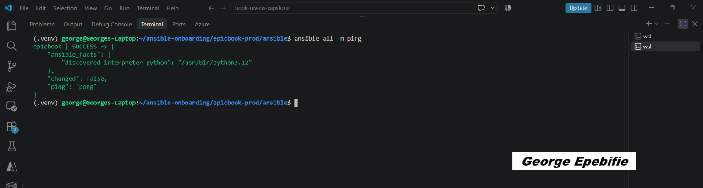

---

#### Screenshot 2 — Output of `ansible-playbook -i inventory.ini site.yml --syntax-check`

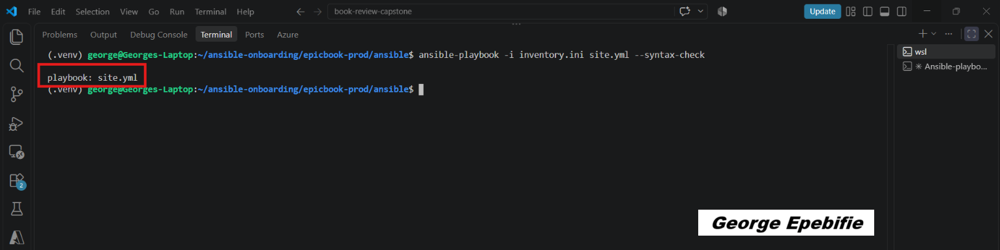

---

#### Screenshot 3 — Output of `pwd` and `find . -maxdepth 4 -type d | sort`

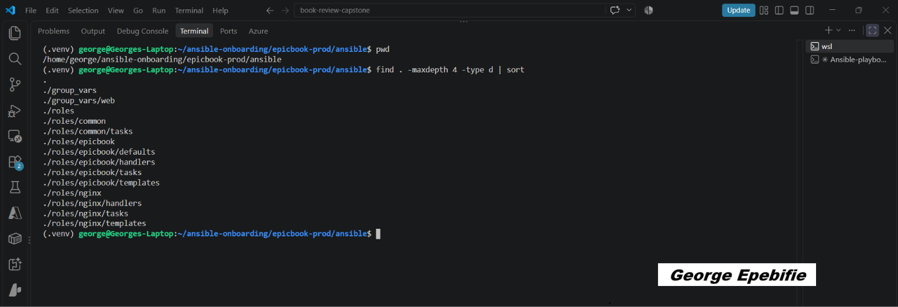

---

### Notes

Answer the following in your own words:

**1. What proves that Ansible can reach your EpicBook VM?**

The command:

ansible web -i inventory.ini -m ping

returned:

epicbook | SUCCESS
"ping": "pong"

The pong response proves that the Ansible controller successfully communicated with the EpicBook VM.

---

**2. Why should you confirm playbook syntax before building a risk-review script?**

The risk-review script relies on a valid playbook to function correctly. If the playbook contains syntax errors, the workflow cannot generate meaningful change information. Therefore, validating the syntax first ensures that the playbook can be parsed successfully.

---

# Task 2 — Create Project Context and Safety Rules in CLAUDE.md

## Goal

Create a `CLAUDE.md` file that tells Claude Code how this project must behave.

### Evidence

#### Screenshot 4 — `CLAUDE.md` open in VS Code or terminal showing the safety rules

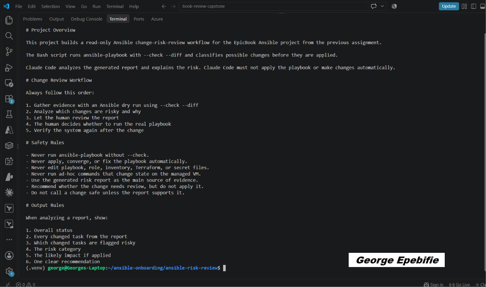

---

### Notes

Answer the following in your own words:

**1. Why should Claude Code have project-specific safety rules?**

Claude Code needs clear instructions about the project's purpose and limitations. In this assignment, it was used to review infrastructure changes rather than apply them. Project-specific safety rules help ensure that Claude Code stays within these boundaries.

Why should the human run the real Ansible playbook manually?

The real Ansible playbook can make changes to a server. Therefore, a human should review the proposed changes and decide whether to proceed, since configuration changes can affect system availability, security, permissions, and data.

Which rule prevents Claude Code from applying changes automatically?

The rule “Never apply, converge, or fix the playbook automatically” prevents Claude Code from making infrastructure changes on its own. It ensures that the changes are reviewed and applied manually by a human.

---

**2. Why should the human run the real Ansible playbook manually?**

The human should run the real Ansible playbook manually because it can make actual changes to the server. Reviewing the proposed changes first helps ensure that they are safe and appropriate before they are applied.

The Gather phase involves collecting evidence from an Ansible dry run using the command:

ansible-playbook --check --diff
The Bash script also captures and stores the raw Ansible output for further analysis.

Which part represents the Analyze phase?

The Analyze phase occurs when Claude Code reads the generated report and explains which changes may be risky, how they are categorized, and what their potential impact could be.
---

**3. Which rule prevents Claude Code from applying changes automatically?**

The rule “Never apply, converge, or fix the playbook automatically” ensures that Claude Code only analyzes and reports on proposed infrastructure changes without applying them. This keeps the final decision and execution under human control.

---

# Task 3 — Ask Claude Code to Plan the Risk Review

## Goal

Use Claude Code to produce a read-only plan before writing the Bash script.

### Evidence

#### Screenshot 5 — Claude Code showing the four-category risk-classification plan

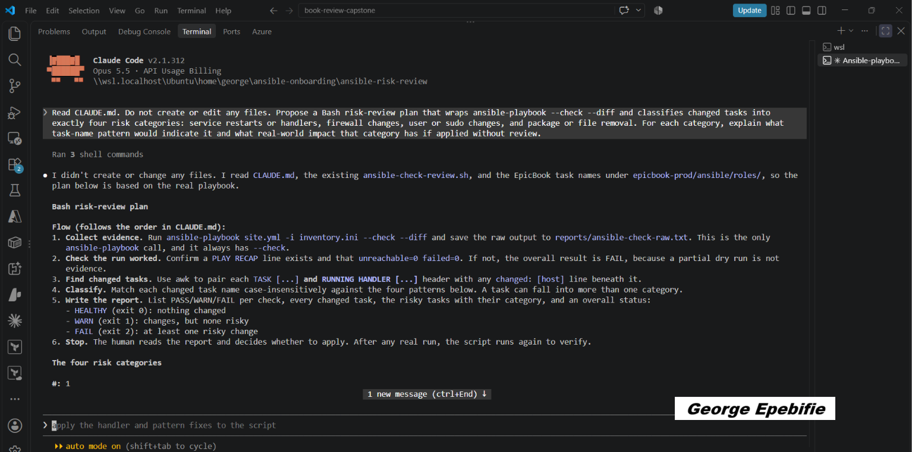
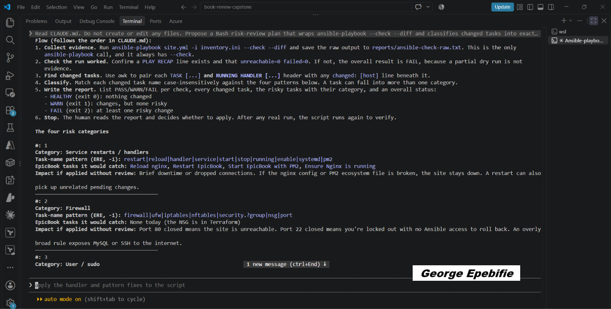
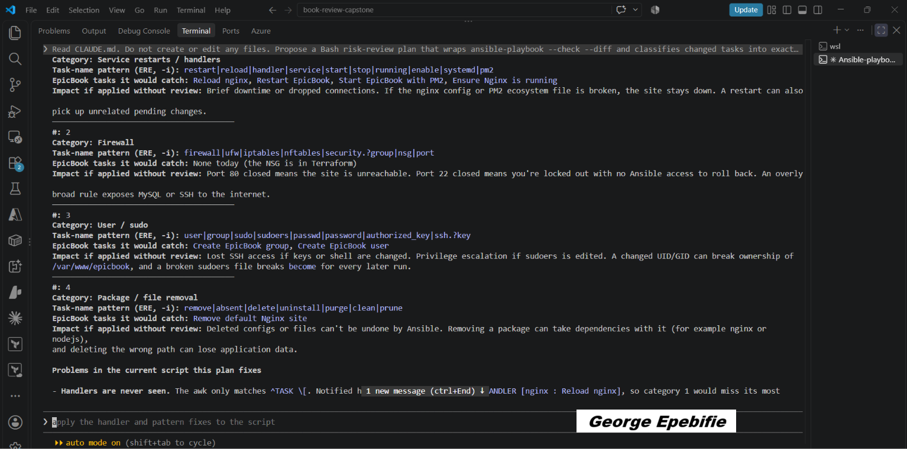
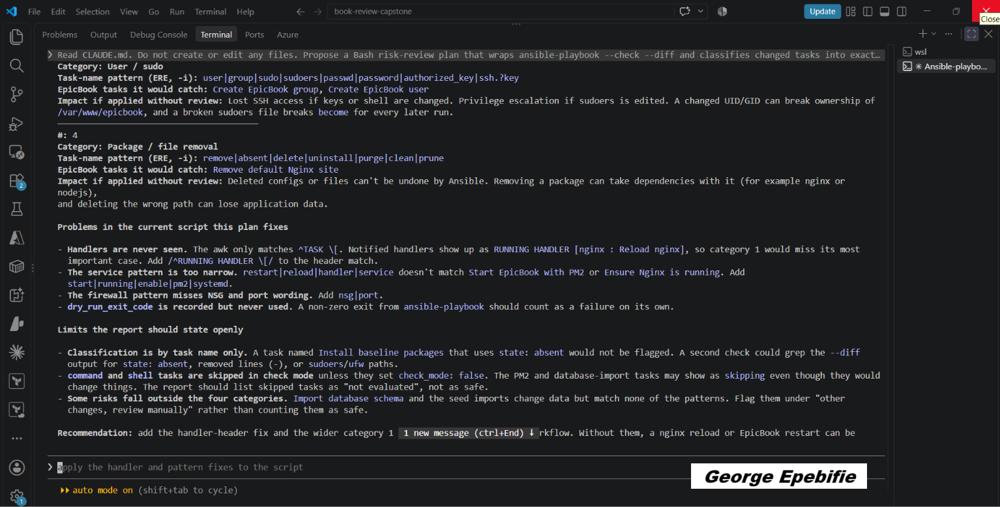
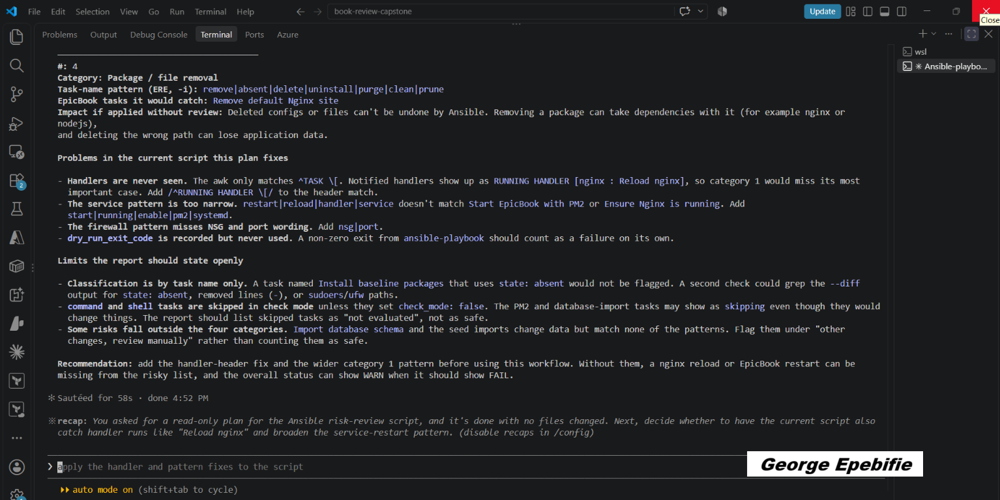

---

### Notes

Answer the following in your own words:

**1. Which part of this task represents the Gather phase?**

The Gather phase involves collecting information from an Ansible dry run using the command:

ansible-playbook --check --diff

The Bash script then captures and saves the raw Ansible output, which serves as evidence for the next stage of analysis.

---

**2. Which part represents the Analyze phase?**

The Analyze phase involves Claude Code reviewing the generated report to identify potentially risky changes, classify them into relevant categories, and explain their possible impact on the infrastructure.

How did you verify Claude Code did not create or edit files?

Claude Code was instructed to perform read only analysis without creating or modifying any files. This restriction was reinforced by the safety rules defined in CLAUDE.md and the skill instructions, which explicitly prohibited file modifications.

---

**3. How did you verify Claude Code did not create or edit files?**

The changed_tasks array stores the names of tasks that Ansible identifies as having potential changes during the dry run. This helps track the proposed changes without actually modifying the infrastructure.

---

# Task 4 — Build the Ansible Risk Review Script

## Goal

Create a Bash script that runs an Ansible dry run and classifies risky changes.

### Evidence

#### Screenshot 6 — Top section of `ansible-check-review.sh` showing `full_name`, `playbook_path`, `inventory_path`, and the `checks` array

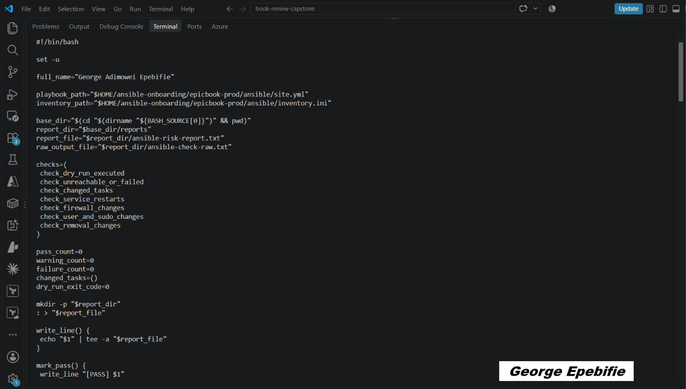

---

#### Screenshot 7 — Middle section showing `extract_changed_tasks` and `check_tasks_matching_pattern`

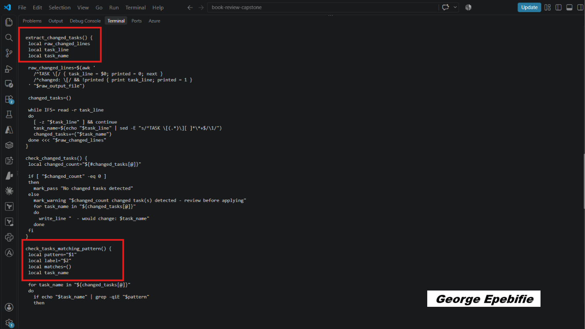

---

#### Screenshot 8 — Bottom section showing the loop, summary, and exit behavior

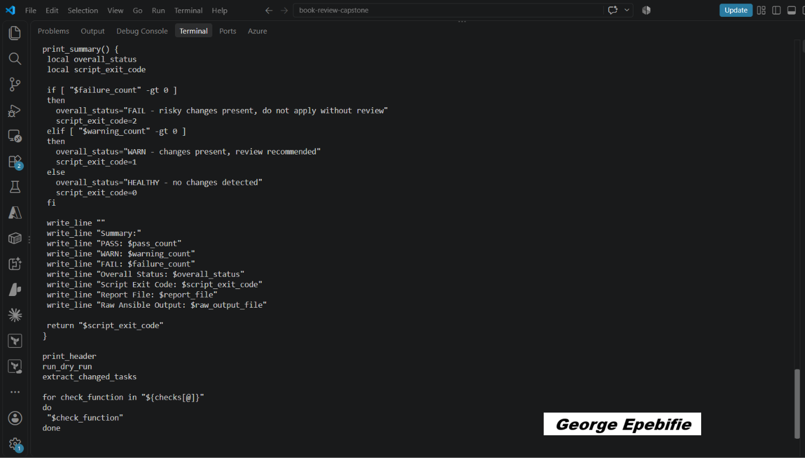

---

#### Screenshot 9 — Output of `bash -n ansible-check-review.sh` and `ls -l ansible-check-review.sh`

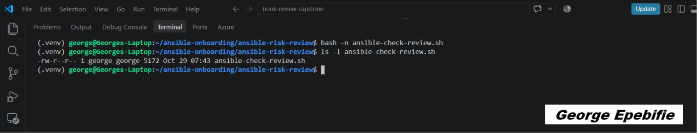

---

### Notes

Answer the following in your own words:

**1. What is stored in the `changed_tasks` array?**

The changed_tasks array contains the names of Ansible tasks that are expected to make changes, as identified during the dry run

---

**2. Which function finds changed tasks from the Ansible output?**

The extract_changed_tasks() function scans the Ansible dry run output to detect tasks reported as changed. It collects these tasks so the script can evaluate their potential risks and categorize them accordingly.

---

**3. Why does the script use `--check --diff`?**

The --check option runs the Ansible playbook in check mode to preview potential changes without applying them. The --diff option displays the differences for supported modules, making it easier to review what would change.

Why does the script use different exit codes?

The script uses different exit codes to indicate the outcome of the review:

0 – Healthy: No significant issues were detected.

1 – Warning: Some changes may require further review.

2 – Risky/Failure: Risky changes or errors were identified.

These codes help users and automation tools quickly determine the result and whether further action is needed.

---

**4. Why does the script use different exit codes for healthy, warning, and failed results?**

TThe script uses different exit codes to distinguish between normal results, changes that need attention, and serious risks or failures. This makes it easier for users and automation systems to understand the review outcome and decide whether further action is required.

For example, the task common: Remove temporary EpicBook risk test file was classified as risky because it matched the script's file-removal detection patterns, such as remove, delete, and state: absent.

The dry-run output indicated that /tmp/epicbook-risk-test would be changed from an existing file to an absent state. Since file deletion can result in data loss or disrupt an application if the wrong file is targeted, the script correctly flagged the operation for human review.

Although the file was intentionally created for testing, the workflow demonstrated how potentially destructive changes can be identified before the real playbook is executed.

---

# Task 5 — Run the Baseline Dry-Run Review

## Goal

Run the script against your current EpicBook playbook and confirm the baseline risk status.

### Evidence

#### Screenshot 10 — Output of `./ansible-check-review.sh`

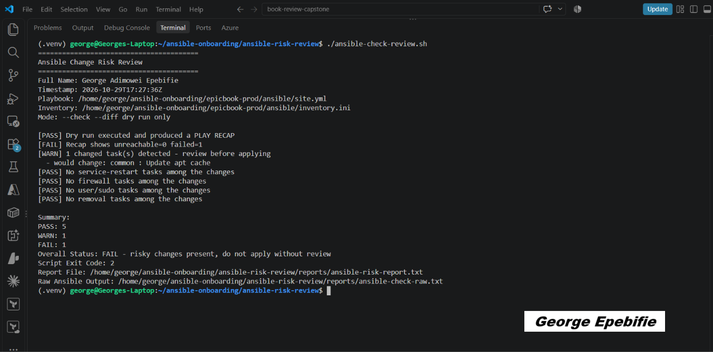

---

#### Screenshot 11 — Output of `echo "Captured Exit Code: $script_exit_code"` and `cat reports/ansible-risk-report.txt`

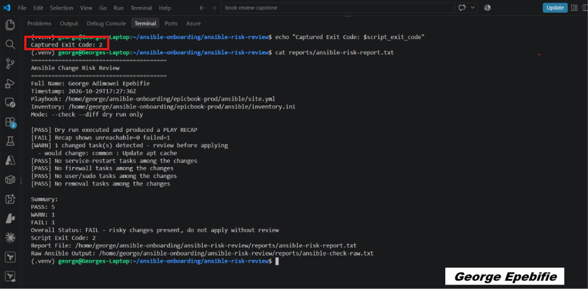

---

### Notes

Answer the following in your own words:

**1. What was the overall status of your baseline run?**

The baseline run returned the status “WARN – changes present, review recommended.”

The Ansible dry run completed without errors, with unreachable=0 and failed=0. However, some tasks were expected to make changes, so the results needed to be reviewed before applying the playbook.

---

**2. Did any tasks report `changed`?**

Yes. The baseline run identified two tasks that were expected to make changes:

common: Update apt cache
epicbook: Install EpicBook dependencies

These changes were detected during the dry run and did not mean that the changes had actually been applied.

---

**3. Were any changed tasks flagged as risky?**

No. None of the changed tasks matched the four high-risk categories defined in the script. Although changes were detected, no specific high-risk operations were identified, so the result was a warning rather than a high-risk failure.

---

**4. What does the script exit code mean?**

The exit code indicates the outcome of the risk review and helps determine whether further attention is required.

Exit code 0: The review completed successfully, and no risky changes were detected.

Exit code 1: Changes were detected, and human review is recommended, but no defined high-risk category was triggered.

Exit code 2: A high-risk change or failure was detected and requires further investigation before proceeding.

In my assignment, the file removal test returned exit code 2 because the script identified the task common: Remove temporary EpicBook risk test file as a potentially destructive operation.

Overall, the exit codes provide a simple way for users, automated systems, and CI pipelines to understand the review results and decide whether further action is necessary.

---

# Task 6 — Create and Run the Claude Code Skill

## Goal

Turn the Bash script into a reusable Claude Code skill called `/ansible-risk-review`.

### Evidence

#### Screenshot 12 — `SKILL.md` showing the frontmatter, allowed tools, and safety rules

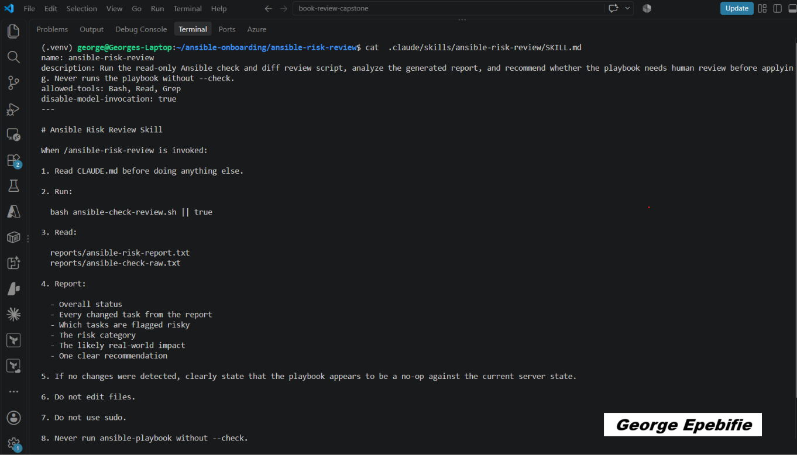

---

#### Screenshot 13 — Claude Code output after running `/ansible-risk-review`

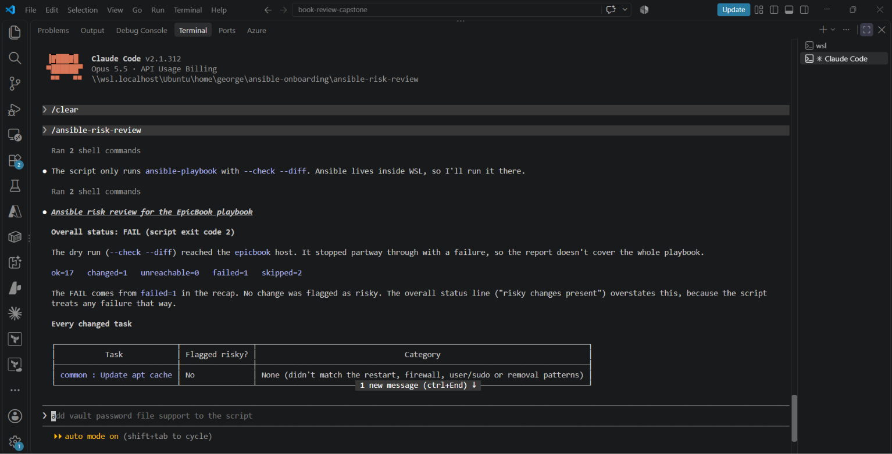
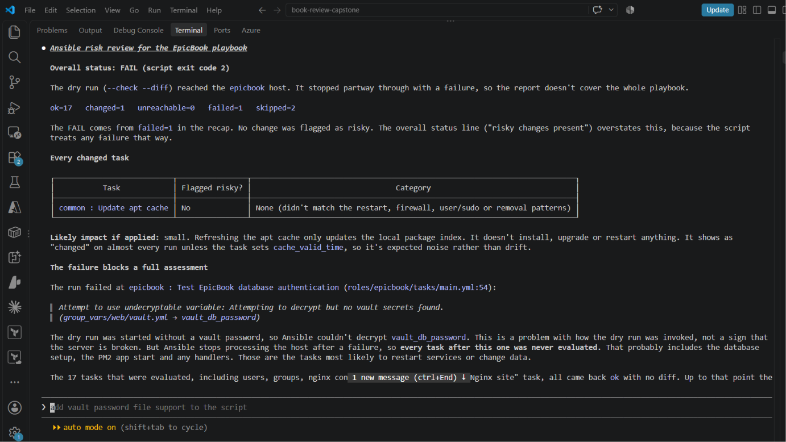
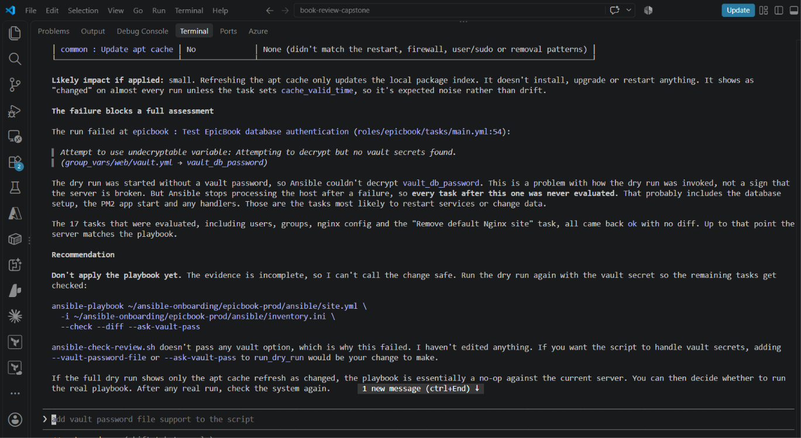
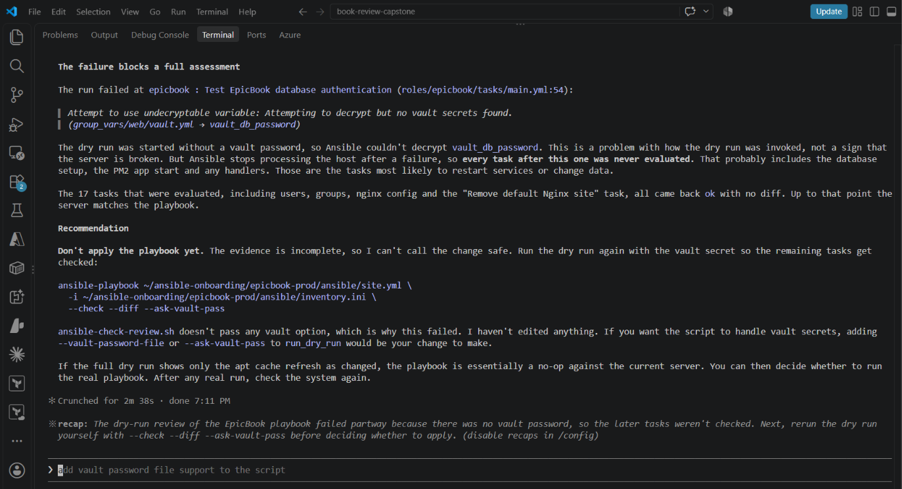

---

### Notes

Answer the following in your own words:

**1. Why does this skill allow `Bash`, `Read`, and `Grep`?**

The skill allows these tools because each one supports a different part of the risk-review process. Bash runs the risk-review script, Read allows Claude Code to examine the generated reports, and Grep helps search for specific tasks, patterns, and evidence in the output.

---

**2. Why does this skill not allow file editing?**

The skill prohibits file editing because its purpose is to inspect and assess infrastructure changes, not modify them. This reduces the risk of unintended configuration changes and ensures that Claude Code only reviews the evidence and provides recommendations. Any actual changes remain under human control.

The skill is designed to perform a read-only safety review of Ansible changes. By explicitly prohibiting file modifications, it ensures that Claude Code can inspect playbooks, review dry-run results, identify potential risks, and suggest improvements without changing infrastructure files.

This maintains a clear separation of responsibilities:

Read → Analyze → Recommend → Human approval → Apply

The separation is important because the tool reviewing a proposed change should not independently modify or apply that change without human approval.

---

**3. What part is handled by Bash?**

Bash handles the automated and rule-based tasks in the workflow. It runs Ansible in check mode, captures the output, identifies tasks that report changes, classifies potential risks, generates a report, and returns an appropriate exit code.

This makes the process consistent and provides concrete evidence for further analysis.

---

**4. What part is handled by Claude Code?**

Claude Code handles the interpretation of the generated report. It explains the detected changes, identifies why certain operations may be risky, describes their potential impact, and presents the findings in language that is easy for a human to understand.

Bash gathers and processes the evidence, while Claude Code helps explain what the results mean.

---

**5. Why is this better than asking Claude Code if the playbook is safe without giving it evidence?**

This approach is more reliable because Claude Code bases its assessment on actual Ansible dry-run output rather than making assumptions about what the playbook might do. The Bash script provides specific evidence about the tasks and proposed changes, allowing Claude Code to produce a more informed risk assessment.

It also makes the review process more transparent because the conclusions can be traced back to the collected evidence.

Using evidence from the Bash script helps reduce guesswork and unsupported conclusions. Instead of judging the playbook based only on its contents, Claude Code can examine the changes identified during the Ansible dry run and explain their potential consequences.

This combination of automated checks and AI-assisted interpretation provides a more structured review process, helping humans make informed decisions before applying infrastructure changes

---

# Task 7 — Introduce a Controlled Risky Change and Let the Skill Catch It

## Goal

Add a small controlled risky change in your lab playbook and confirm the script and Claude Code catch it before applying.

### Evidence

#### Screenshot 14 — The added risky task inside the role file

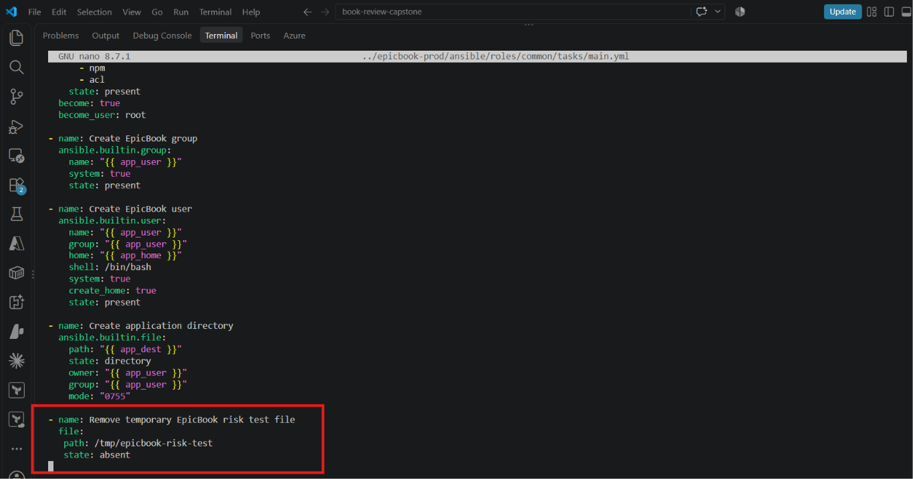

---

#### Screenshot 15 — Output of `./ansible-check-review.sh`

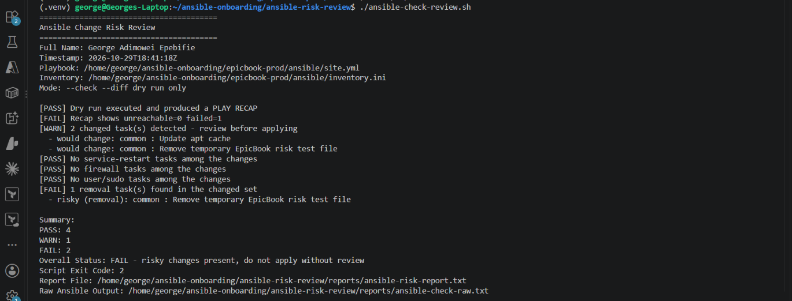

---

#### Screenshot 16 — Claude Code `/ansible-risk-review` output showing the risky finding

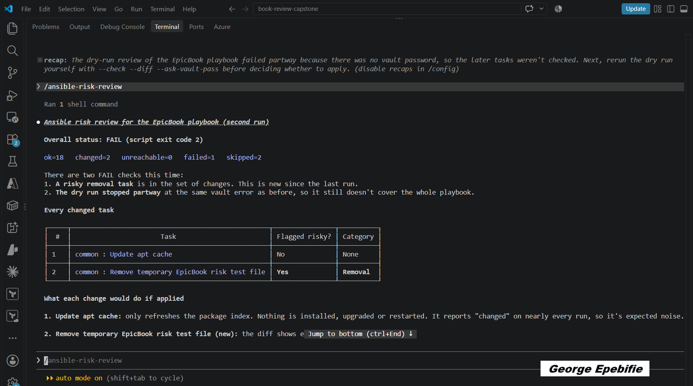
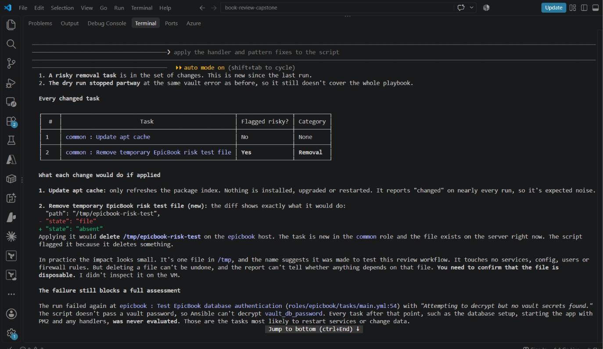
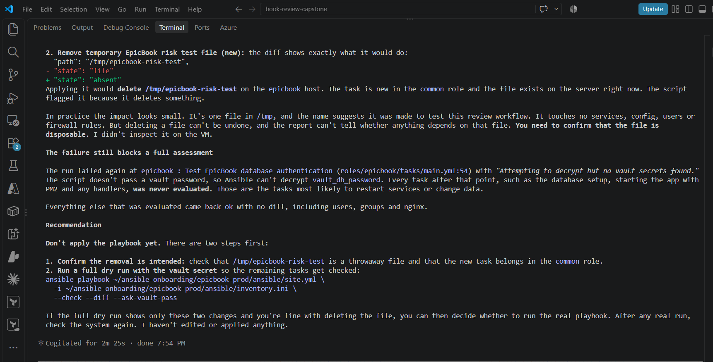

---

#### Screenshot 17 — Output of `cat reports/risky-change-report.txt`

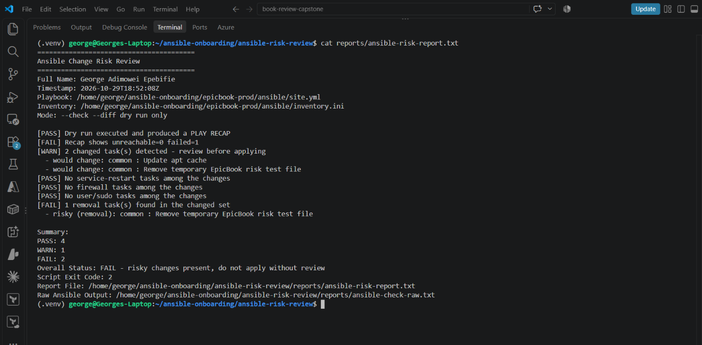

---

### Notes

Answer the following in your own words:

**1. Which risk category did the added task fall into?**

The added task was classified under Package/File Removal because it involved deleting a file. The report identified it as a risky operation: risky (removal): common : Remove temporary EpicBook risk test file

---

**2. What evidence proves the task would change something?**

The Ansible dry-run output indicated that the task was expected to make a change:

would change: common : Remove temporary EpicBook risk test file

The Bash script then recognized the removal operation as potentially risky and flagged it in the report. This provided evidence that the task required review before being applied.

---

**3. Did Claude Code apply the playbook?**

No. Claude Code only examined the generated report and explained the identified risks. I manually ran the real Ansible playbook afterward, keeping the execution of infrastructure changes under my control.

---

**4. Why is it important that Claude Code only analyzed the risk?**

Keeping Claude Code focused on analysis ensures that a human remains responsible for approving and applying infrastructure changes. This is especially important for destructive operations, such as deleting files, which could cause data loss or disrupt a service if applied incorrectly.

---

**5. Which phase of the Agentic Loop is represented by the Bash report?**

The Bash report mainly represents the Gather phase because it collects and records evidence from the Ansible dry run. It also performs basic risk classification, which supports the Analyze phase by helping Claude Code interpret the results and explain potential risks.

---

# Task 8 — Apply as the Human, Verify, and Write the Change Summary

## Goal

Review the risky-change report, apply the playbook manually as the human operator, and verify the result.

### Evidence

#### Screenshot 18 — Output of the real playbook run showing the final recap with `failed=0`

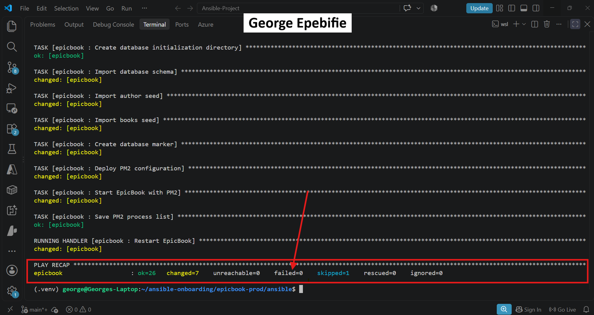

---

#### Screenshot 19 — Output of `ansible web -i inventory.ini -m ping`

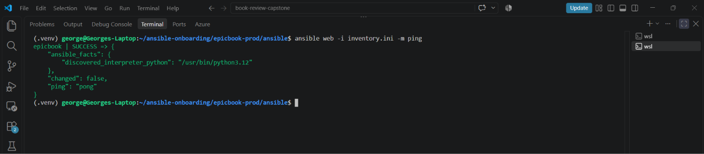

---

#### Screenshot 20 — Second `/ansible-risk-review` output after applying the change

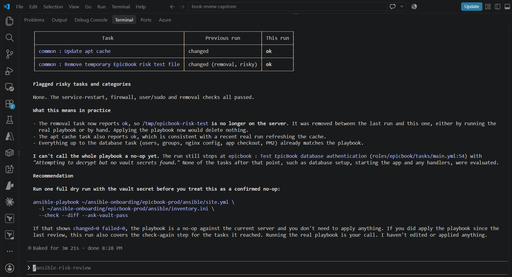

---

#### Screenshot 21 — Output of `ls -lah reports`

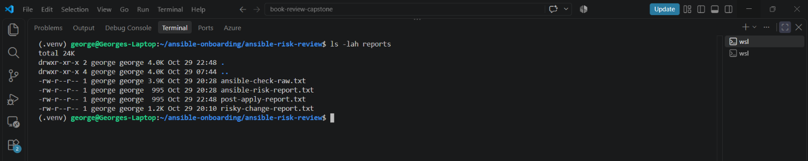

---

#### Screenshot 22 — `change-summary.md` showing all required sections and your Full Name

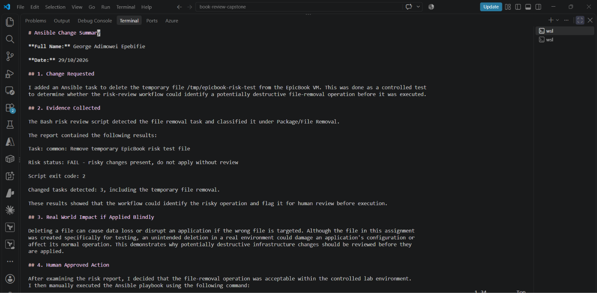
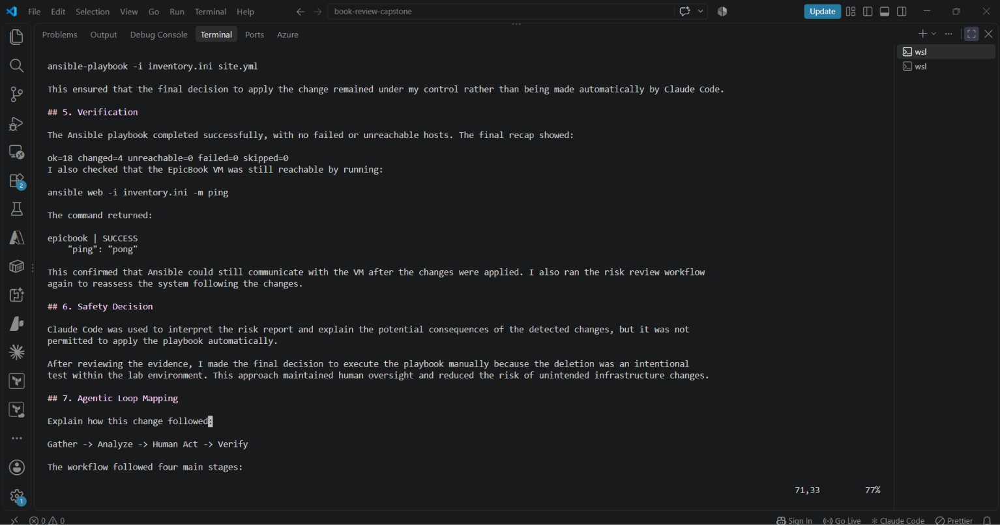
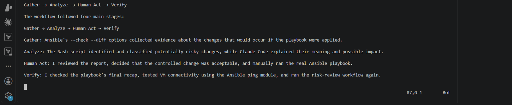

---
### Notes

Answer the following in your own words:

**1. What command did you run to apply the change for real?**
I manually executed the following command to apply the changes defined in the Ansible playbook:

ansible-playbook -i inventory.ini site.yml

This ran the playbook against the hosts specified in the inventory and applied the intended configuration changes.
---

**2. Who made the final decision to apply the playbook?**

I made the final decision after reviewing the risk report and understanding the potential impact of the proposed changes. This ensured that the playbook was only executed after human review and approval.

---

**3. What evidence proves the VM is still reachable?**

I checked the VM's connectivity by running the Ansible ping module:

ansible web -i inventory.ini -m ping
The command returned the following result:

epicbook | SUCCESS
    "ping": "pong"
This confirms that Ansible could successfully communicate with the VM after the playbook was applied.
---

**4. Why should the risk review be run again after applying?**
Running the risk review again helps assess the system's state after the changes have been applied. It provides updated information about the remaining changes and can reveal unexpected differences that may need further investigation.

This additional check helps verify the outcome of the deployment and identify potential issues before they become bigger problems.

---

**5. What could go wrong if an AI agent applied Ansible changes automatically?**

An AI agent could make infrastructure changes without fully understanding their consequences or receiving human approval. This could lead to serious problems, including:

Data loss: Important files or packages could be deleted.

Service downtime: Critical services could be restarted or misconfigured.

Security issues: Firewall rules, user permissions, or SSH access could be changed incorrectly.

Compatibility problems: Installing or updating packages could cause application failures.

Configuration errors: The agent could misunderstand the task and apply unintended changes.

In this assignment, the temporary file-removal task demonstrated why this precaution matters. The risk-review script identified the deletion as a high-risk operation and returned exit code 2, indicating that human review was required before proceeding.

The key lesson is that AI can help identify risks and explain proposed changes, but the human should retain responsibility for approving and applying infrastructure changes.
---

# LinkedIn Post Required

## Evidence

#### LinkedIn Post URL

<https://www.linkedin.com/posts/wisgeorge1_dmibypravinmishra-devops-cloudcomputing-ugcPost-7524441266525433856-Y6gn/?utm_source=share&utm_medium=member_desktop&rcm=ACoAADp8HhoB_UGFhHiID8Ba-4DVResYfMJJsuY>

---

#### Screenshot — Published LinkedIn post

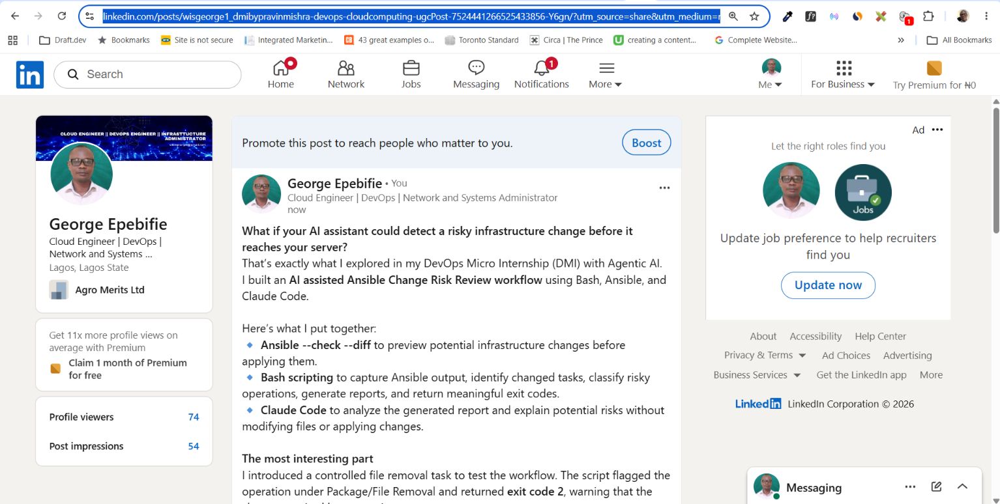

---

# Required Files

Confirm that the following files are included in your GitHub repository or assignment folder:

- [ ] `CLAUDE.md`
- [ ] `ansible-check-review.sh`
- [ ] `.claude/skills/ansible-risk-review/SKILL.md`
- [ ] `reports/risky-change-report.txt`
- [ ] `reports/post-apply-report.txt`
- [ ] `change-summary.md`

---

# Submission Instructions

- Add all required screenshots in your submission.
- Full Name must be visible in required screenshots and reports.
- All required notes must be answered clearly.
- Do not expose SSH private keys, passwords, cloud credentials, database credentials, or secret environment variables.
- Add your GitHub repository or folder URL inside this document.

---

# Completion Checklist

- [ ] Task 1: EpicBook connectivity confirmed and workspace created
- [ ] Task 2: `CLAUDE.md` created with safety rules
- [ ] Task 3: Claude Code produced a read-only risk-review plan
- [ ] Task 4: `ansible-check-review.sh` created and syntax checked
- [ ] Task 5: Baseline dry-run review completed
- [ ] Task 6: Claude Code `/ansible-risk-review` skill created and tested
- [ ] Task 7: Controlled risky change introduced and detected
- [ ] Task 8: Human applied the change and verified the result
- [ ] Risky-change report saved
- [ ] Post-apply report saved
- [ ] Change summary completed
- [ ] All screenshots added
- [ ] All notes answered
- [ ] LinkedIn post published
- [ ] LinkedIn post URL added
- [ ] No sensitive information exposed

---

## About DMI & CloudAdvisory

DevOps Micro Internship (DMI) is a project-based DevOps program run by Pravin Mishra and The CloudAdvisory, focused on real-world execution, systems thinking, and career readiness.

It helps learners build strong DevOps foundations with hands-on experience.

---

## Resources

- DMI Official Website: [https://dmi.pravinmishra.com?utm_source=github&utm_medium=readme](https://dmi.pravinmishra.com?utm_source=github&utm_medium=readme)
- University: [https://university.pravinmishra.com?utm_source=github&utm_medium=readme](https://university.pravinmishra.com?utm_source=github&utm_medium=readme)
- Discord Community: [https://discord.pravinmishra.com?utm_source=github&utm_medium=readme](https://discord.pravinmishra.com?utm_source=github&utm_medium=readme)
- Blog: [https://dmi.pravinmishra.com/blog?utm_source=github&utm_medium=readme](https://dmi.pravinmishra.com/blog?utm_source=github&utm_medium=readme)
- YouTube Playlist: [https://www.youtube.com/playlist?list=PLFeSNDtI4Cho](https://www.youtube.com/playlist?list=PLFeSNDtI4Cho)
- Pravin Mishra LinkedIn: [https://www.linkedin.com/in/pravin-mishra-aws-trainer/](https://www.linkedin.com/in/pravin-mishra-aws-trainer/)
- CloudAdvisory LinkedIn: [https://www.linkedin.com/company/thecloudadvisory/](https://www.linkedin.com/company/thecloudadvisory/)

---

*This submission is part of DevOps Micro Internship (DMI) — Agentic AI Track.*
